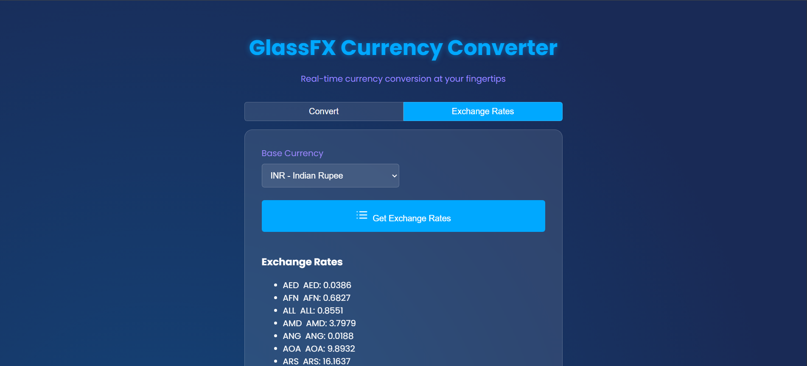

<div align="center">

# 💱 GlassFX Currency Converter

### 🌍 Real-Time Currency Conversion at Your Fingertips

A modern currency converter featuring a beautiful dark interface, glassmorphism effects, and exchange-rate functionality.

<br>


<br>


**Convert currencies. Explore exchange rates. Experience GlassFX.**

</div>

---

## 📌 About the Project

**GlassFX Currency Converter** is a web application that allows users to convert amounts between different currencies and retrieve exchange-rate information through a modern, user-friendly interface.

The project combines interactive JavaScript functionality with a visually appealing dark theme, cyan accents, and glassmorphism-inspired styling.

## ✨ Features

* 💱 **Currency Conversion** — Convert amounts between selected currencies.
* 🌍 **Multiple Currencies** — Select source and target currencies.
* 📈 **Exchange Rates** — Retrieve exchange-rate information for a selected base currency.
* 🔄 **Interactive Controls** — Select currencies using dropdown menus.
* 🎨 **Glassmorphism UI** — Modern design with translucent elements.
* 🌙 **Dark Theme** — Elegant dark blue background with cyan and purple accents.
* 📱 **Responsive Design** — Designed to adapt to different screen sizes.
* ⚡ **Simple Interface** — Easy-to-use conversion controls.
* ⚠️ **Error Handling** — Display feedback when an API request fails.

---

## 🖥️ Project Screenshots

### 💱 1. Currency Converter

Convert currencies by entering an amount and selecting the source and target currencies.

<div align="center">


</div>

### 📈 2. Exchange Rates

Retrieve exchange-rate information for your selected base currency.

<div align="center">



</div>

---

## 🛠️ Technologies Used

| Technology        | Purpose                                 |
| ----------------- | --------------------------------------- |
| HTML5             | Website structure                       |
| CSS3              | Styling, layout, and visual effects     |
| JavaScript        | Currency conversion and API integration |
| Exchange Rate API | Exchange-rate data retrieval            |

*The API name should match the provider used in your actual JavaScript code.*

---

## 📂 Project Structure

```text
Currency-Converter/
│
├── Screenshots/
│   ├── Covert Page.png
│   └── Exchange-Rate-Page.png
│
├── index.html
├── styles.css
├── script.js
└── README.md
```

---

## 🚀 Getting Started

### Prerequisites

Before running the project, make sure you have:

* A modern web browser, such as Google Chrome.
* An internet connection for exchange-rate API requests.
* Visual Studio Code (optional).

### Installation

**Step 1: Clone the repository**

```bash
git clone https://github.com/YashGunjal9/Currency-Converter.git
```

**Step 2: Navigate to the project directory**

```bash
cd Currency-Converter
```

**Step 3: Open the project**

Open the project folder in Visual Studio Code.

**Step 4: Run the application**

Open `index.html` in your browser or use the Live Server extension in Visual Studio Code.

**Step 5: Convert currencies**

1. Enter the amount you want to convert.
2. Select the source currency in the **From** dropdown.
3. Select the target currency in the **To** dropdown.
4. Click **Convert**.
5. Open the **Exchange Rates** tab to retrieve rates for the selected base currency.

---

## 🔌 Exchange Rate API

The application uses an exchange-rate API to retrieve currency information.

If your project uses ExchangeRate-API's Open Access service, you can consult its documentation:

**[ExchangeRate-API Documentation](https://www.exchangerate-api.com/docs/free)**

API availability, supported currencies, request limits, and update frequency depend on the selected provider.

---

## 🎯 Project Objectives

* Develop an interactive currency converter using web technologies.
* Practise HTML, CSS, and JavaScript.
* Integrate an external API into a web application.
* Create an attractive and user-friendly interface.
* Handle API responses and network errors.
* Improve front-end development and problem-solving skills.

---

## 🔮 Future Enhancements

* 🔄 Add a swap-currencies button.
* 🕘 Maintain a conversion history.
* 📊 Display interactive exchange-rate charts.
* 💰 Display currency symbols automatically.
* 🌐 Support additional currencies.
* ⚡ Improve loading indicators and error messages.
* 📱 Further enhance the mobile experience.

---

## 👨‍💻 Developer

<div align="center">

### Yash Gunjal

Computer Engineering Student | Web Developer

[](https://github.com/YashGunjal9)

**Project Repository**

[GlassFX Currency Converter](https://github.com/YashGunjal9/Currency-Converter)

</div>

---

<div align="center">

### ⭐ Enjoying this project?

If you find this project useful, consider giving the repository a star!

**Built with 💙 using HTML, CSS, and JavaScript.**

</div>
